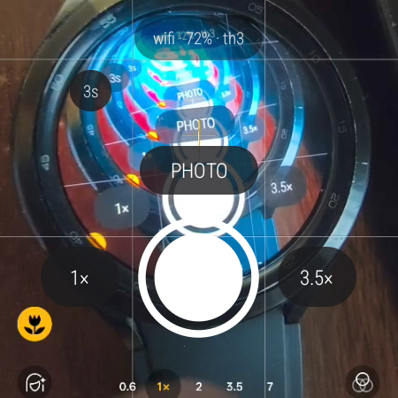
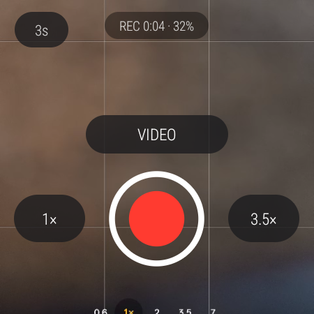
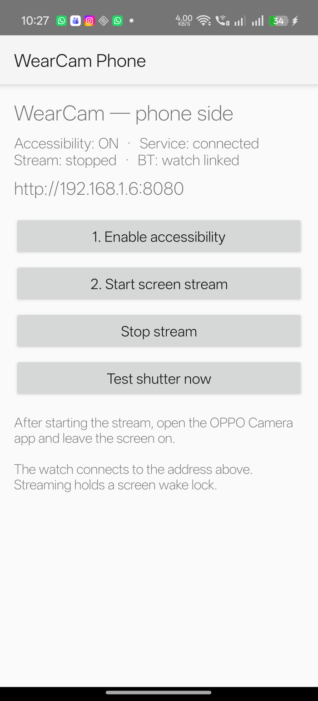
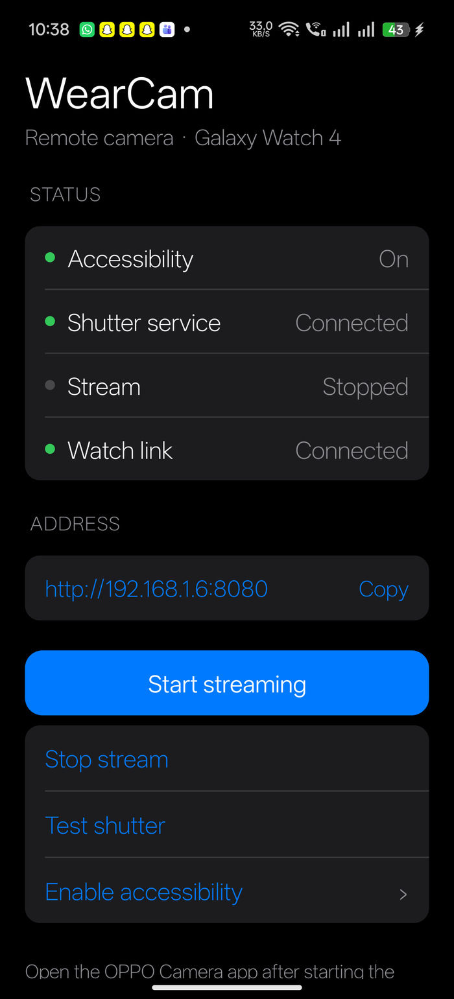
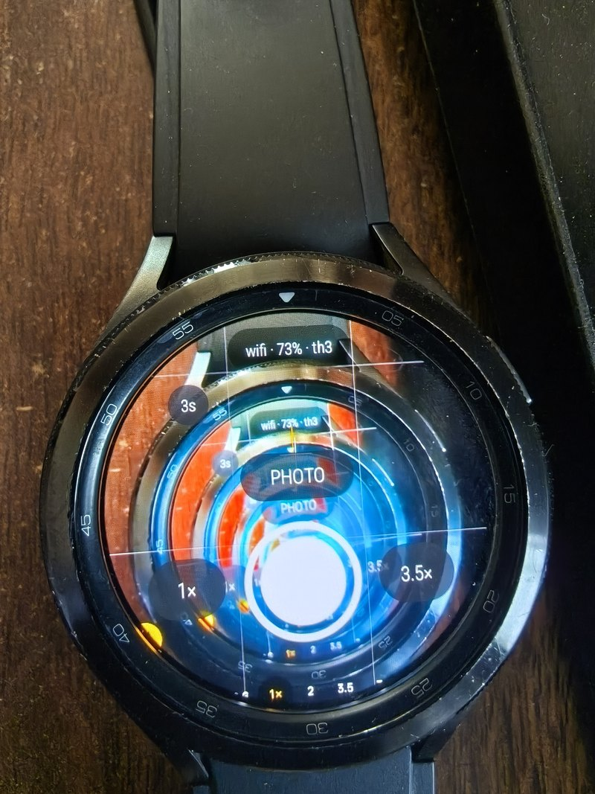

# WearCam — Galaxy Watch 4 remote camera for OPPO Reno14 Pro


[](LICENSE)

Control the OPPO camera from a Galaxy Watch 4: live preview, shutter, video
record, 3-second timer, zoom presets and mode switching — no root, no Shizuku.
The phone side is an iOS-style control panel with grouped status cards and
light/dark palettes.

| Watch | Recording | Phone | Phone (dark) |
|---|---|---|---|
|  |  |  |  |

The real device, shot by the phone camera while streaming — the round display is
why the timer sits at 10 o'clock instead of the square corner:



## Architecture

```
Galaxy Watch 4 (450x450)                     OPPO Reno14 Pro 5G
┌──────────────────────┐   RFCOMM (BT)   ┌───────────────────────────┐
│ SurfaceView  H.264   │◀───────────────▶│ BtBridge  (server)        │
│ strip / mode pill    │                 │ CaptureService            │
│ 1x  3.5x  shutter    │   TCP /video    │  MediaProjection 480x1056 │
│ status capsule       │◀───────────────▶│  H264Encoder 480x480      │
└──────────────────────┘                 │  MjpegServer :8080        │
                                         │ ShutterService (a11y)     │
                                         └───────────────────────────┘
```

- **Video**: MediaCodec AVC 480×480, 30 fps target, 2.5 Mbps CBR. Same framed
  packets over BT (RFCOMM) and Wi-Fi (`/video`); the watch prefers Wi-Fi and
  falls back to BT automatically.
- **Control**: BT commands `S` shutter/record, `I`/`O` pinch, `Z:<preset>`
  zoom, `B:<x>,<y>` mode-bar tap, `T:<x>,<y>` focus, `M:<n>` mode intent.
  The phone reports `SHOT`, `REC` / `STOP` (record start/stop) and
  `MODE=<name>;BAT=<pct>;TH=<thermal>` status lines.
- **Modes**: deterministic intents discovered from the camera's launcher
  shortcuts (`mode=0 photo, 2 portrait, 6 video`); PRO/MORE via the strip.
- **Shutter**: accessibility click on the camera's shutter node, with a
  coordinate fallback at `(0.5w, 0.816h)` for the video record button.
- **Timer**: the `3s` pill arms a 3-2-1 countdown before the shutter command.
- **Recording**: the status capsule switches to a live `REC m:ss` counter and
  returns to the transport/battery line when the phone reports `STOP`.
- **State machines**: link, transport, mode, countdown, recording (watch) and
  capture, record (phone) are explicit enum machines with logged transitions
  and JVM tests — see [STATE-MACHINES.md](STATE-MACHINES.md). Every transition
  appears in logcat as `WearCamState <machine>: FROM --EVENT--> TO`.

## Build

```
./gradlew assembleDebug
adb install -r phone/build/outputs/apk/debug/phone-debug.apk
adb install -r watch/build/outputs/apk/debug/watch-debug.apk
```

CI builds both APKs on every push and publishes them with each `v*` tag.

Phone: Developer options → Wireless debugging; grant Accessibility for the
phone app (Settings → Apps → WearCam Phone → Accessibility) and the CAMERA
permission. Watch: enable Wireless debugging for sideloading only.

> Re-enabling Accessibility is required after every reinstall — Android drops
> the service on app updates. `adb shell settings put secure
> enabled_accessibility_services com.gajuk.wearcam/com.gajuk.wearcam.ShutterService`
> restores it without the Settings UI.

## Verified on hardware

| Path | Encoder | Watch decoder |
|---|---|---|
| Wi-Fi TCP | 30.2 fps | 26.9–30.0 fps |
| BT RFCOMM | 15.3 fps | 14.2–15.8 fps |

Mode switching: `PHOTO ↔ PORTRAIT ↔ VIDEO` via intents, < 1 s, independent of
the camera UI. Shutter writes 12.6 MP JPEGs; recording toggles the stock
camera's recorder (verified: 70 MB / 116 MB clips, `REC 0:04` counter).

## ColorOS 16 notes

- The projection dialog is requested with `MediaProjectionConfig
  .createConfigForDefaultDisplay()` (targetSdk 35), so it defaults to
  **Entire screen**. If you pick **A single app** instead, ColorOS hides the
  camera preview with "App content hidden from screen share" and the watch
  shows black.
- While casting, ColorOS also hides the WearCam app's own window from
  screenshots — the phone control panel appears black in `screencap` while a
  stream is live. The watch stream itself is unaffected.

## Known limits

- Android 14 allows one VirtualDisplay per projection, so H.264 is encoded
  from the RGBA frames (YUV conversion on a worker thread) rather than a
  second display.
- Accessibility cannot read the video record button's window; the coordinate
  fallback assumes the stock layout (`y = 0.816 × height`).
- Wi-Fi host is configured on the watch (long-press the status capsule) and
  persisted; BT is the fallback.

## RE notes

The OPPO camera exposes only `capturePreview` (a preview-frame grab) beyond the
standard camera activities; `DebugBroadcastReceiver` and the tuning/settings
activities are gated by OPPO system permissions. Launcher shortcuts are the
only non-privileged way to select a camera mode.
