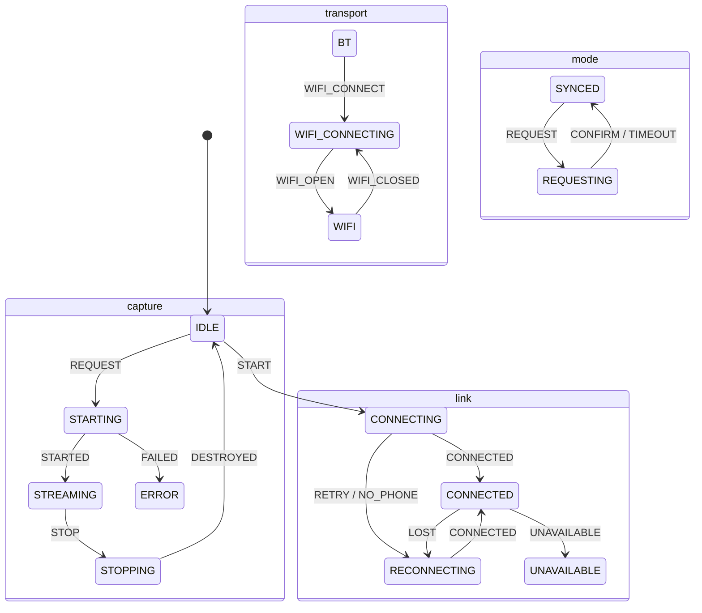

# State machines

Every user-visible lifecycle in WearCam is an explicit, typed state machine. State used to live
in strings and booleans spread across threads (`"bt: retry"`, `wifiVideo`, `recording`,
`requested`, `running`); it now has one enum state, one transition table, one log line per
transition, and JVM tests.

## Engine

`common/src/main/java/com/gajuk/wearcam/common/StateMachine.java`

- `send(event)` returns the next state; invalid events are **logged and ignored** (never thrown).
- Every accepted transition logs `WearCamState <machine>: FROM --EVENT--> TO`, tagged
  `WearCamState` in logcat — the whole system's state is grep-able and inspectable.
- `addListener((from, to, event) -> …)` gives owners a typed callback.
- `StateMachine.setLogger(...)` routes logs (logcat in the apps, a collector in tests).

## Explicit machines

| Machine | Module | States | Events | Owns |
|---|---|---|---|---|
| `link` | watch | `IDLE`, `CONNECTING`, `CONNECTED`, `RECONNECTING`, `UNAVAILABLE` | `START`, `CONNECTED`, `LOST`, `RETRY`, `NO_PHONE`, `UNAVAILABLE` | capsule text + spinner, reconnect semantics |
| `transport` | watch | `BT`, `WIFI_CONNECTING`, `WIFI` | `WIFI_CONNECT`, `WIFI_OPEN`, `WIFI_CLOSED` | which source may feed the decoder, `wifi`/`bt` label |
| `mode` | watch | `SYNCED`, `REQUESTING` | `REQUEST`, `CONFIRM`, `TIMEOUT` | mode pill over the phone-reported mode list; optimistic request reverts after 3 s without confirmation |
| `countdown` | watch | `IDLE`, `COUNTING` | `START`, `FINISH`, `CANCEL` | 3 s timer; a second press cannot start an overlapping countdown |
| `recording` | watch | `IDLE`, `RECORDING` | `START`, `STOP` | `REC m:ss` counter and its timestamp |
| `capture` | phone | `IDLE`, `STARTING`, `STREAMING`, `STOPPING`, `ERROR` | `REQUEST`, `STARTED`, `STOP`, `FAILED`, `DESTROYED` | stream lifecycle; duplicate start cannot create a second virtual display |
| `record` | phone | `IDLE`, `RECORDING` | `START`, `STOP` | `REC`/`STOP`/`SHOT` statuses; leaving video mode stops the recorder |



## Invariants

- Exactly one video source feeds the decoder: `transport == WIFI` drops BT frames; `!= WIFI`
  drops Wi-Fi frames.
- Exactly one countdown at a time; the shutter fires once, on `FINISH`.
- Exactly one projection per service; a duplicate `REQUEST` while `STARTING`/`STREAMING` is
  ignored.
- `REC`/`STOP` strictly alternate; a mode change away from video reports `STOP` if recording.
- Invalid events never throw; they log `(ignored)`.

## Intentionally derived (not machines)

| State | Why it stays derived |
|---|---|
| strip / config visibility | pure view state; no transitions worth naming |
| `timerArmed` | a user preference toggle, not a lifecycle |
| phone BT link (`out != null`) | single writer under `WRITE_LOCK`; the UI reads `isConnected()` |
| legacy MJPEG preview (`httpRunning`) | superseded by the H.264 transport; kept for compatibility, slated for removal |
| encoder acquire/submit | MediaCodec owns the codec lifecycle |
| MJPEG/VideoHub client counts | atomic counters, no transitions |
| accessibility `instance` | framework-owned lifecycle |
| phone status rows | recomputed from the machines on `refresh()` |

## Tests

```
./gradlew :common:test :watch:testDebugUnitTest :phone:testDebugUnitTest
```

`StateMachineTest` covers the engine (valid/invalid/self transitions, listeners, logging);
`WatchMachinesTest` and `PhoneMachinesTest` cover every transition table.

## Adding a machine

1. Declare `State` and `Event` enums; implement the pure `transition(from, event)` table.
2. Add JVM tests for each row of the table.
3. Wire it at the edges only: `send(...)` where the event happens, `state()` where the UI reads.
